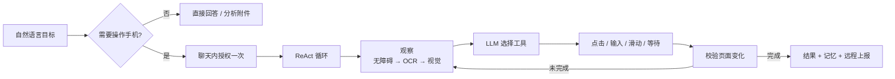

<div align="center">
  

  <h1>CatfeeAgents</h1>

  **会聊天，也能替你操作手机的 Android LLM Agent**

  统一对话 · 通用原子工具 · 本地多模态 · 全链路可观测

  <br />

  
  
  
  
  

  <br />

  [快速开始](#快速开始) · [核心能力](#核心能力) · [工作方式](#工作方式) · [工具系统](#工具系统) · [常见问题](#常见问题)
</div>

---

> **不绑定任何 App。** 没有针对某款应用的包名判断和专用流程，所有能力都由通用原子工具 + 页面识别组合完成。聊天、看图、读文件、操作手机，都在同一个输入框里。

## 核心能力

| | 能力 | 说明 |
| :--: | --- | --- |
| 💬 | **统一对话** | 普通问答、附件分析、手机操作共用一个输入框，不用先选 Chat / Agent 模式。需要碰手机时，模型自己请求进入设备模式。 |
| 🧵 | **多会话并发** | 多个聊天会话可以同时运行；切换会话不会打断另一个会话。设备操作全局只允许一个 Agent，冲突时提示并可重试，聊天仍可继续。 |
| 👁 | **状态看得见** | 通知栏和可选悬浮条实时显示「第 N 步 · 等待模型 / 操作中 / 等待确认」、运行时长和最后活动时间，支持一键停止或回到会话。 |
| 🧠 | **本地多模态** | 无障碍树优先；读不到时降级到 ML Kit、PP-OCRv5、滚动长截图和视觉模型。图片附件先在本地 OCR，再把文字交给 LLM。 |
| 🧰 | **原子工具** | 点击、长按、滑动、输入、按键、启动 App、读页面、截图、OCR、等待、校验、记忆、计划等都可独立调用，可组合出任意任务。 |
| 🗂 | **会话管理** | 历史会话支持搜索、置顶、收藏、归档、重命名、导出 Markdown；消息可复制、引用、编辑重发、重新生成、分支出新会话。 |
| 🧭 | **按 App 记忆** | 每个包名一套结构化记忆（入口 / 控件 / 坑 / 流程 / 偏好），带选择器、置信度、使用次数和互链；每轮按任务相关性注入核心记忆，其余留给 `memory_search`。 |
| 📊 | **用量与成本** | 每个会话显示 tokens、上下文长度、消息/步骤数、累计耗时；可配置每 1M token 单价估算费用。 |
| 📡 | **统一远程日志** | 可选绑定内置 Web 控制台，异步上报每一步输入、模型输出、工具参数与结果；本地聊天和 Web 任务共用同一套设备凭证，不再需要第三方 JWT。 |
| 🖥 | **Web 控制台** | 仓库内提供 Nuxt 单端口控制台：设备注册、任务下发、实时事件、暂停/继续/停止与审计。Agent 主动通过 WebSocket 接入，Web 端不直接操作设备。 |
| ⚡ | **DECISION 加速** | 可选接入百炼 decision 接口，高置信度时跳过主模型的 observe / wait；默认关闭，点击、输入和完成仍由主模型决定。 |

## Web 控制台

[`web/console`](web/console) 是面向已授权设备的远程 Agent 管理端，与 APK 共用
黑白红扁平设计。Nuxt 4 单端口同时承载页面、REST API、SSE 和 Agent WebSocket，
数据存储在本地 SQLite。默认示例适合内网；公网部署请放在 HTTPS 反向代理后，
设备使用 WSS。

```bash
cd web/console
pnpm install
pnpm dev        # http://localhost:9777
```

首次启动创建管理员 `admin / change-me`，可用环境变量覆盖。
详见 [Web 控制台文档](docs/web-console.md)、
[Agent 协议契约](contracts/README.md) 与 [OpenAPI](contracts/openapi.yaml)。
UI 重做可直接使用 [双端 UI 提示词](docs/ui-prompts-ardot.md) 与
[Web UI 需求清单](docs/web-ui-requirements.md)。

## DECISION 加速（可选）

设置 → 模型 → DECISION 加速，默认关闭。

- Base URL / Key / 模型默认从 `local.properties` 的 `decision.baseUrl`、`decision.apiKey`、`decision.model` 读取，构建时写入 BuildConfig，不会进入仓库；其他开发者未配置时可在 App 内手动填写。
- 开启后，高置信度时由百炼 decision 接口接管 `observe` / `wait`，跳过该轮主模型；点击、输入、`finish` 仍由主模型决定，避免分类器误操作。
- 可调最小置信度（默认 0.75）和最多连续快速步数（默认 3）；连续失败两次会自动停用本次任务的 DECISION。
- 动作完成后会自动 `observe` 一次，把新页面直接带回上下文；这类步骤不再额外询问 DECISION。`observe` 快速路径使用更低的 0.35 安全阈值，`wait` 仍按配置阈值。
- DECISION 只在可能 `observe/wait` 的步骤调用：动作后、等待后、页面加载中或无变化时；`load_tools`、`find_text`、`todo` 等结果确定的步骤直接交给主模型。
- 单次 DECISION 超过 2 秒，或调用 6 次后平均超过 600ms，会自动停用本次任务；每次调用都会记录 action / confidence / latency / used / loading。
- 本地实测（同一部署、同一把 Key）：路由决策中位数约 **124ms**（手机端稳态约 **200ms**，首次含 TLS 握手约 **1.1s**），`deepseek-v4.1-flash` 做同样的下一步判断约 **955ms**。实际任务提速取决于能跳过主模型的步骤占比。
- 真实淘宝场景对比（非 Root，同一目标，DDR4 3600 16GB 最低价）：SimpleMode **91.8s / 345.8K tok / 68 步**；DecisionMode 两次为 **134.8s / 487.8K tok / 86 步** 和 **139.8s / 558.5K tok**。这个以点击、滑动、详情页探索为主的场景里 DECISION 反而更慢：快路径只覆盖 `observe/wait`，其余步骤仍要主模型，且分类器可能带来额外观察步骤。建议只在等待/读取型任务开启，点击密集任务保持关闭。

复现实测：

```bash
set DASHSCOPE_API_KEY=your-key
node scripts/bench-decision.mjs
```

## 快速开始

### 1. 环境要求

| 项目 | 要求 |
| --- | --- |
| 系统 | Android 8.0+（API 26） |
| 架构 | `arm64-v8a` / `armeabi-v7a` |
| Root | 可选。Magisk 或可用的 `su` 用于 uinput 注入、快速截图和系统级操作；无 Root 时走无障碍 + 系统截图 |
| 无障碍 | 开启 CatfeeAgents 的无障碍服务；非 Root 设备必需（Android 11+ 才支持系统截图） |
| 通知 | Android 13+ 需授予通知权限，否则看不到 Agent 状态 |
| 构建 | JDK 17、Android SDK 36 |
| 网络 | 能访问所配置的 OpenAI 兼容接口；远程日志默认访问 `https://api.catfee.cn` |

> **Root 是增强项，不是使用前提。** Android 11+ 无 Root 设备开启无障碍后即可读屏、点击、滑动、输入、启动 App，并使用系统无障碍截图做 OCR/视觉；Root 设备保留完整能力。Android 8–10 无 Root 暂不支持截图，详见[非 Root 模式](#非-root-模式)。

### 2. 构建与安装

```bash
# Windows
gradlew.bat assembleDebug

# macOS / Linux
./gradlew assembleDebug
```

```bash
adb install -r app/build/outputs/apk/debug/app-debug.apk
```

APK 输出：`app/build/outputs/apk/debug/app-debug.apk`

### 3. 开启无障碍

安装或强制停止 App 后，部分系统会关闭无障碍服务，需要重新开启：

```bash
adb shell settings put secure enabled_accessibility_services \
  com.catfee.rootauto/com.catfee.rootauto.a11y.UiObserverService
adb shell settings put secure accessibility_enabled 1
```

也可以手动进入「设置 → 无障碍 → 已下载的应用 → CatfeeAgents」开启。

### 4. 安装 Root daemon（可选，仅 Root 设备）

`uinput` 点击/滑动依赖常驻 daemon。仓库已带 `daemon/dist` 预编译产物，可直接打包 Magisk 模块：

```powershell
powershell -ExecutionPolicy Bypass -File magisk/build-magisk.ps1
```

把生成的 `dist/CatfeeRootAuto-v1.0.0.zip` 刷入 Magisk 并重启。修改过 C 源码时，先重新编译：

```powershell
powershell -ExecutionPolicy Bypass -File daemon/build.ps1
```

### 5. 配置模型

打开右上角菜单 → **设置 → 模型**：

1. 填写 `Base URL`（OpenAI 兼容地址，填到 `/v1` 或只填域名均可）；
2. 填写 `API Key`；
3. 填写模型 ID，例如 `deepseek-v4.1-flash`；
4. 点 **拉取模型列表**，接口返回的模型会全部列出来，点任意一个即可切换并保存；
5. 也可以手动填写模型 ID 后点 **保存模型配置**。

设置页顶部的能力标签会显示 `无障碍 / 手势 / 截图 / Root / 悬浮窗` 状态，以及 `完整模式 / 无障碍模式 / 仅聊天模式`。API Key 与 Web 控制台设备凭证使用 `EncryptedSharedPreferences` 保存。

### 6. 开始任务

直接描述目标即可，例如：

```text
打开设置，查看当前 Android 版本，然后返回
```

```text
把当前页面的问卷填完，逐题核对后再提交
```

```text
看看这张截图里有哪些可点击的按钮，帮我点进设置
```

首次需要读取/操作手机时，聊天框内会弹出一次授权卡；允许后本会话不再询问。运行中可随时停止，步骤会实时出现在会话时间线和通知栏。

## 工作方式



- **能力门控**：聊天模式只发 `enter_agent_mode`；进入设备模式后加载核心工具，表单、视觉、文件、系统等能力按需 `load_tools`，不绑定任何具体 App。
- **单动作事务**：每轮最多执行一个 UI mutation；执行前检查工具/坐标，执行后只对 mutation 做自适应稳定等待，并要求下一轮基于新页面验证。
- **失败安全**：坐标越界、媒体不确定、等待停滞、控件歧义、页面无进展等返回 `BLOCKED/失败` 语义，不会被当成成功继续盲点。
- **坐标统一**：所有工具使用当前**显示方向**坐标；注入前按 rotation 转成设备 natural 坐标，越界直接拒绝。
- **上下文预算**：最多 48 条消息 / 32K 字符；system 消息原位更新，工具结果和会话观察缓存按 Agent run 隔离。
- **证据优先**：页面文字、进度、节点 checked/selected 和动作前后页面指纹优先于颜色或视觉猜测；业务成功条件由用户目标和当前页面证据决定。

## 工具系统

工具集固定为 16 个轻量工具，不再提供“精简/完整”模式切换：

```text
enter_agent_mode  observe  ocr  tap  swipe  input  key  wait
find  scroll  open  todo_write  todo_read  note  memory
request_capability  finish
```

- `tap(by=text|desc|id|xy, value=...)` 合并了 `tap_text/tap_node/tap_desc/tap_id/long_press/double_tap`
- `swipe(direction=...)` 合并了坐标滑动与方向滑动
- `open(app="中国移动")` 支持应用名关键字，不需要先 `list_packages` 查包名
- `input(text, x, y)` 在无障碍没有可编辑节点时自动走剪贴板粘贴
- `observe` 在无障碍树为空时自动 OCR；`find/tap/scroll` 也会 OCR 兜底
- `ocr` 保留为整屏 OCR 入口，用于图片/WebView 等需要读文字的场景
- `memory` 统一了 read/write/search/list/delete
- 不再暴露 `load_tools/see_screen/read_page/screenshot/verify_*` 等慢速或低频入口

旧的 60 个工具定义与实现仍保留在代码内部，仅用于兼容历史会话，不暴露给模型。

实测（V2302A）：中国移动三项拨测 **35 步 / 142.9s** 完成（旧工具集 49 步 / 202.9s）；微信朋友圈完整读取 **13 步 / 36.1s** 完成。

## 会话、记忆与成本

- **会话列表**：`最近 / 置顶 / 收藏 / 归档` 四个视图，支持搜索；每行右侧 `⋮` 可置顶、收藏、归档、重命名、导出 Markdown、删除。
- **自动标题与摘要**：新会话根据首轮对话生成短标题和摘要；手动重命名后不再自动覆盖。
- **会话检查点**：同一会话每次请求都会带紧凑的原始目标、上次任务清单、结果和最近执行步骤；由模型按当前消息语义判断是新任务还是继续，不靠“继续”关键词。
- **消息操作**：长按可复制、引用、编辑并重发、重新生成，或从该消息分支出新会话。
- **附件**：一次最多 6 个；支持多图和多文件同时上传。图片本地 OCR；PDF 渲染前 6 页后 OCR；DOCX/XLSX/PPTX 解包提取文本；单文件上限 30MB。
- **模型**：点击输入框下方的模型名，可只切换当前会话的模型，不影响全局默认和其他会话。
- **记忆中心**：`设置 → 记忆` 查看、编辑、删除按 App 隔离的结构化记忆；Web 控制台设备详情页也会展示设备上传的记忆，可直接编辑或删除（通过 `MEMORY_UPDATE / MEMORY_DELETE` 指令下发）。
- **统计**：`设置 → 统计` 查看 token、上下文、耗时，配置每 1M token 单价估算费用。

### 记忆系统

参考 Mem0 / Letta / Zep / LangMem 的做法，记忆从“整段 markdown”升级成结构化条目：

- **条目字段**：类型（入口/控件/坑/流程/偏好）、页面/路径、正文、选择器（`text=` / `desc=` / `id=` / `xy=`）、前置条件、置信度、成功/失败次数、最后验证时间、互链。
- **相关性注入**：每轮按 `0.45 × 相关性 + 0.20 × 新近度 + 0.20 × 置信度 + 0.15 × 使用率` 打分，只注入 top-K（默认 800 字）；找不到时模型再调 `memory_search` 检索归档。
- **合并而不是追加**：任务结束后由后台整理器（`MemoryCurator`）输出 `add / update / delete / noop`，相同控件或相似文本会合并；修复了旧版“写满 1200 字后新记忆被截断丢弃”的问题。
- **失败也沉淀**：动作失败、控件不可用、重复无效会记成 `pitfall`，置信度上限 0.55，重复验证后再提升。
- **版本与遗忘**：记录 App 版本；版本变化时提示模型校正旧条目；长期未验证且从未成功的条目不参与注入，并在整理时淘汰。
- **互链**：一条记忆可以链接同 App 的其它记忆，注入时在预算允许下带上一跳关联项。
- **后台整理**：任务结束只把摘要写入队列，LLM 合并在后台异步执行，不阻塞任务返回；App 启动或下次任务结束会继续处理未完成的队列。
- **多设备聚合**：设备绑定 Web 控制台后，记忆快照通过 WebSocket `memory_sync` 上报，按 `(deviceId, package)` 存储，可在控制台查看/编辑/删除。

## Agent 状态

Agent 运行时，通知栏显示：

```text
Agent · 第 12 步 · 等待模型
最后动作：observe
已运行 03:42 · 最后更新 2s 前
```

阶段包括 `等待模型 / 操作中 / 等待确认 / 已暂停 / 已完成 / 已停止 / 异常`。通知提供 **打开、暂停/继续、停止**；控制动作带当前 session id，只影响当前 Agent owner。

设置中可开启 **悬浮状态窗**（需授予悬浮窗权限）。悬浮窗是贴右侧居中的深色状态卡，显示步骤、阶段、耗时和最后动作，并提供 **暂停/继续、停止** 按钮；Agent 注入手势命中悬浮窗时会临时让点击穿透到下层 App，手势结束自动恢复。停止需要两步确认（第一次点 `×` 变成「确认」，3 秒内再点一次），避免误触或 Agent 点击把任务停掉。截图/OCR 前会自动隐藏状态条，避免它进入识别结果。暂停是进程内协作式暂停，不会取消原任务 Job；停止后需要重新发起任务。

### 屏蔽无障碍的 App（微信等）

部分 App 不向无障碍暴露节点（实测微信主/分身都是空树），任务会自动切换：

- `observe` 检测到空树时改用 **本地 OCR**，返回带坐标的文字行；`find_text`、`tap_text`、`scroll_to_text` 在无障碍无命中时也会自动 OCR 兜底。
- 输入文字时如果找不到可编辑节点，`input_text(text, x, y)` 会写剪贴板、点输入框、再点输入法工具栏里的剪贴板建议完成粘贴；不会把文本写进本应用后台窗口。
- `launch_app` 遇到 vivo 应用分身选择框会自动选择不带「Ⅱ」的主应用。
- 这类 App 优先用 `ocr`/坐标操作，不要反复 `see_screen`。

### 能力缺失时会主动引导

任务遇到能力缺失不会直接结束：

- **无障碍**：Root 设备先用 `settings put secure` 自动恢复服务；非 Root 打开系统无障碍详情页并轮询等待（本地任务 90 秒，远程任务 90 秒）。如果系统里已勾选但服务未连接，会提示关闭再重新开启。
- **悬浮窗 / 通知 / 后台运行**：打开对应系统设置并等待授权；设置页也提供「开启无障碍」入口。
- **Root**：无法由 App 自动开启，但只作为增强项，不是运行前提。没有 Root 时提示模型改用无障碍完成，不会因此结束任务。
- 模型可以主动调用 `request_capability(name=accessibility|overlay|notification|battery|screenshot|root)`；开启成功后刷新能力快照，下一轮工具列表自动放行。

## 通用表单与选项任务

`answer_form` 是通用能力，只在用户明确要求填写、回答、核对或提交表单/问卷时启用；它不识别或依赖任何具体 App、课程或业务名称：

1. 使用无障碍树、ML Kit、PP-OCR 和长页面滚动收集题干/选项；
2. 选项真实存在性和题目结构先做质量检查，低质量 OCR 才回退慢引擎；
3. 三模型首次请求并行，按字母集合投票；补答次数和补答范围有固定预算，不会无限裂变；
4. 点击前后优先读取 checked/selected，像素只作兜底；实际选中集合必须等于目标集合；
5. 单选也会清理旧选项，提交前从顶部重新全量复查；存在未确认题目时禁止提交；
6. 长页面坐标明确区分 documentY 和 viewportY，整页坐标不能直接用于 tap。

## Web 控制台日志与远程任务

绑定一次后，本地聊天日志、Web 任务日志和远程控制共用同一条设备长连接：

1. 启动 `web/console`，登录后在「设备」页生成一次性注册码（8 位 `ABCD-2345`，10 分钟有效），页面同时展示绑定二维码；
2. APK `设置 → 控制台` 输入注册码点 **绑定**，或点 **扫码绑定** 直接扫描二维码，自动填入地址与注册码；
3. 绑定成功后自动启用前台长连接；Web「设备」页显示在线即可下发任务。

事件以服务端 `taskId` 写入任务时间线：`task.started`、`agent.task.step`、`task.paused / resumed / stopped / succeeded / failed`。本地聊天任务使用 `local_` 前缀，只写日志，不改变 Web 任务状态。

任务策略 `allowRoot` / `allowScreenshot` 会在设备端再次校验；未授权时对应工具直接隐藏并返回可行动原因。上报内容包括任务信息、每步模型 `content / reasoning / tool_calls`、工具参数与结果、LLM 耗时、异常和最终结果。文本单步最多 6000 字符，单条工具结果最多 2000 字符，**不上传截图二进制**。

设备只保存 `deviceId + deviceSecret`，不需要管理员 Token 或 JWT；Web 撤销设备后长连接立即失效。调试包也可以通过 adb 绑定：

```bash
adb shell am broadcast -a com.catfee.rootauto.DEBUG \
  -n com.catfee.rootauto/.DebugReceiver --es cmd consolebind \
  --es baseUrl http://192.168.1.100:9777 --es code <一次性注册码>
```

## 目录结构

```text
app/src/main/java/com/catfee/rootauto/
├── MainActivity.kt              # 统一对话、会话、附件、设置
├── agent/
│   ├── ReActAgent.kt            # 主循环、流式、工具编排、上下文裁剪
│   ├── AgentTools.kt            # 工具定义、分组与门控
│   ├── ToolRuntime.kt           # 工具实现与页面校验
│   ├── AgentController.kt       # 多会话运行、Agent 全局锁、状态
│   ├── FormSolver.kt            # 通用选项式表单/答题
│   ├── AppMemory.kt             # 结构化记忆门面（兼容旧 UI/工具）
│   └── memory/
│       ├── MemoryModel.kt       # 条目模型、打分、遗忘曲线、行编解码
│       ├── MemoryStore.kt       # 每 App JSON 存储、旧 md 迁移、合并/淘汰
│       ├── MemoryInjector.kt    # 相关性检索、core/归档、互链
│       └── MemoryCurator.kt     # 后台整理队列与 ADD/UPDATE/DELETE/NOOP
├── a11y/UiObserverService.kt    # 无障碍树、滚动、文本输入
├── session/
│   ├── SessionStore.kt          # 会话/消息/附件/token 持久化
│   ├── SessionManager.kt        # 会话切换、分支、裁剪
│   ├── SessionExporter.kt       # Markdown 导出
│   └── AttachmentAnalyzer.kt    # 图片 OCR / PDF / Office / 文本解析
├── ocr/
│   ├── OcrEngine.kt             # ML Kit + PP-OCR 合并
│   ├── PaddleOcrEngine.kt       # PP-OCRv5 ONNX 推理
│   └── LongOcr.kt               # 滚动拼接长页 OCR
├── root/
│   ├── RootShell.kt             # libsu root shell
│   ├── DaemonClient.kt          # uinput / 截图 daemon
│   ├── ScreenGeometry.kt        # display ↔ natural 坐标转换
│   └── ScreenVision.kt          # 截图 + 视觉模型
├── service/
│   ├── AgentStatusService.kt    # 前台通知 + 悬浮状态条
│   └── DisplaySettings.kt       # 悬浮窗开关
├── console/                     # 设备凭证 / WebSocket / 远程任务执行
├── llm/                         # LlmClient / LlmSettings / UsageSettings
└── log/                         # AgentTrace → /api/agent/events

app/src/main/assets/ocr/         # PP-OCRv5 det/rec ONNX
daemon/                          # native 输入注入守护进程
magisk/                          # Magisk 模块
```

## 关键设计

| 主题 | 做法 |
| --- | --- |
| 页面读取 | 无障碍优先，空节点/画布降级到 OCR 和视觉模型；观察/验证/OCR/媒体缓存按 run 隔离；屏外节点标 `[屏外]` |
| 坐标 | 工具坐标统一为显示坐标；用 `dumpsys input` 的 `SurfaceOrientation` 校准；旋转时优先无障碍手势；越界直接拒绝 |
| 媒体 | 只有多重播放器证据才认定为媒体；按实测进度分段等待；停滞、不确定或 OCR 冲突时阻断盲等 |
| 动作安全 | 每轮最多一个 mutation；动作前检查、动作后验证；只对 mutation 做 settle；重复目标无进展时阻断 |
| 长任务 | `wait_media`/`wait_for_text` 分段执行并可暂停；LLM 超过 20 秒发心跳；Web 任务默认不限制时长（可手动暂停/停止），本地聊天保留默认总预算；步数仍有上限 |
| 控制 | Agent 可从主界面、通知栏和悬浮窗暂停/继续/停止；暂停不取消原 Job，停止需要重新发起 |
| 流式 | SSE 增量输出；统一总请求超时和可重试错误分类，服务端不支持 SSE 时回退普通请求 |
| 安全 | `shell` 禁止 UI 注入；远程日志不上传截图；Key/设备凭证加密存储；源码不含真实密钥 |

## 常见问题

<details>
<summary><b>长任务看起来卡住了？</b></summary>

先看会话时间线或通知栏是否还有「等待模型 / 等待页面」心跳。如果有，说明是在等模型或等页面；如果心跳停止且长时间没有新步骤，再检查网络、无障碍服务和 LLM 接口。上下文超过 48 条消息或 32K 字符会自动裁剪，单条工具结果最多保留 8K。
</details>

<details>
<summary><b>安装或强停后无障碍失效？</b></summary>

重新执行第 3 节的 `settings put secure ...` 命令，或手动在系统设置里开启。部分 ROM 每次覆盖安装都会重置无障碍授权。
Root 设备在 Web 任务启动前会尝试自动恢复本应用的无障碍服务，并在任务日志里提示结果。
</details>

<details>
<summary><b>任务反复点输入框，却不输入文字？</b></summary>

`input_text`、`observe`、`tap_text` 等工具依赖无障碍服务。Root 设备覆盖安装或强停后，
部分 ROM 会重置无障碍授权；新版本会在 Web 任务启动前尝试用 Root 自动恢复，
失败时任务日志会明确提示「无障碍未开启：文字输入和读屏工具不可用」。
非 Root 设备请在系统设置中手动开启 CatfeeAgents 的无障碍服务。

Root 只增强 shell、文件、系统设置、停止 App 和 uinput 手势，**不能替代无障碍的中文文本输入**。
因此 Root 设备同样需要无障碍服务；Root 的价值是可以在授权丢失后自动把无障碍重新打开。
</details>

<details>
<summary><b>OCR 读不到浅色题号或小字？</b></summary>

优先用 `long_ocr`：它会滚动扫描并拼接整页，再按真实偏移还原坐标。PP-OCRv5 对浅色文字更敏感，ML Kit 对短选项字母更稳，两个引擎会合并结果。确保测试时屏幕常亮。
</details>

<details>
<summary><b>远程日志没有数据？</b></summary>

检查 `设置 → 日志` 的开关、绑定项目和「上报成功」状态；确认日志系统筛选的项目/时间范围正确；JWT 被吊销后需要重新生成校验码换取。
</details>

<details>
<summary><b>三个模型答案不一致？</b></summary>

按票数多数；三票全分歧时取平均置信度最高者。模型自评置信度不代表真实正确率，最终结果仍可能波动。
</details>

## 安全与隐私

- Root 权限可以执行高权限操作，请只在测试机或受控设备上使用；
- LLM Key 与 Web 控制台设备凭证使用 `EncryptedSharedPreferences` 保存，不写入日志；
- Web 日志会包含页面文字、工具参数与结果，请确认控制台账号的访问权限；
- 不上传截图二进制；文本和工具结果会按长度截断；
- 源码不包含真实 API Key；`local.properties` 已加入 `.gitignore`。

## P0 / P1 / P2 修复状态

| 优先级 | 状态 | 已落地内容 |
| --- | --- | --- |
| P0 | 已完成 | 单轮单 mutation、动作失败语义、表单实际选中集合校验、单选旧答案清理、提交前全量复查、动态滚动坐标、双击三击回退修复 |
| P1 | 已完成 | 媒体长 wait 拦截、停滞检测、媒体缓存隔离、三模型并行和补答预算、统一 180s LLM 总超时、只对 mutation settle、暂停/继续/停止、悬浮窗/通知控制 |
| P2 | 基本完成 | 文本候选消歧、OCR 质量门槛、documentY/viewportY 区分、read_page 截断说明、按 run 的观察/OCR/媒体缓存 |
| 仍需真机验证 | 持续 | 不同 ROM、WebView、自绘页面、不同播放器和复杂表单的准确度需要设备回放数据验证；远程日志服务端权限/历史隔离仍取决于服务端实现 |

## 非 Root 模式

Android 11+ 且无障碍已开启时，无需 Root 即可：

- 无障碍读树、节点点击、坐标手势、滑动、长按、输入文本、返回/Home/最近任务
- `PackageManager` / `Intent` 启动应用、打开链接、查询包信息
- `AccessibilityService.takeScreenshot` 系统截图 → 本地 OCR / 视觉模型 / 表单

非 Root 下明确不支持：`shell`、`settings_put`、任意路径文件读写、`stop_app`、Magisk 模块安装，以及 Android 8–10 的截图（后续可加 MediaProjection）。设置页会按能力自动隐藏/拒绝这些工具，并显示当前模式。

## 已知限制

- **非 Root 能力边界**：Android 11+ 可使用无障碍手势与系统截图；`shell`、`settings_put`、任意路径文件、`stop_app`、Magisk 模块仍需要 Root；Android 8–10 无 Root 暂不支持截图；`FLAG_SECURE` 页面无法截图；
- **Agent 全局单例**：聊天可以并发，但同一时间只允许一个会话操作手机；
- **暂停是进程内暂停**：暂停不会取消当前 Job，但 App 进程被系统杀死后不能自动恢复原执行点；
- **媒体/表单是通用能力而非业务流程**：Agent 不知道任何 App 的业务完成条件，必须依赖用户目标和页面证据；
- **远程 trace 的服务端历史隔离**：App 侧每个 run 已使用不可变 TraceContext 隔离 task_id/目标/模型/包名；服务端历史查询和权限隔离仍取决于日志服务端接口实现；
- **通知读取 / 分享面板接入**：尚未实现，当前通过无障碍和主动截图获取页面。

## 构建信息

| 项目 | 值 |
| --- | --- |
| 应用名 | `CatfeeAgents` |
| applicationId | `com.catfee.rootauto`（包名保持不变，兼容已授权的无障碍/日志配置） |
| 版本 | `1.0.0`（versionCode `10000`） |
| SDK | compileSdk 36 / targetSdk 34 / minSdk 26 |
| UI | Jetpack Compose + Material 3 |
| OCR | ML Kit Chinese + ONNX Runtime（PP-OCRv5） |
| 网络 | OkHttp |
| 输入注入 | native daemon + uinput |
| JDK | 17 |

## License

内部项目，未声明开源许可证。
